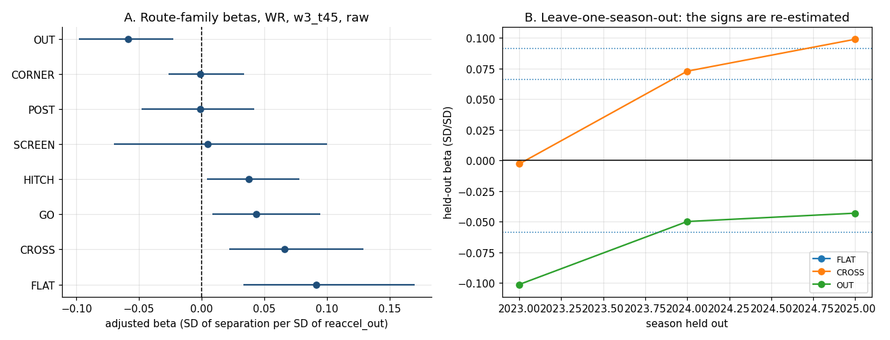

# 折返后的再加速和接球空间

外接手在体测中折返后的再加速能力，和比赛中甩开防守人的距离有关吗？我从 10 Hz 的 NFL Combine 轨迹找出转向点，提取减速和再加速指标，再与同一球员在常规赛里的跑位数据关联。

我分析了 **83 名外接手的 31,035 条路线**。再加速与传球时防守间距的标准化关联在 FLAT 和 CROSS 为正（+0.0915、+0.0660），在 OUT 为负（−0.0588）。逐个留出赛季复查，CROSS 有 2/3 次保持原方向，OUT 有 3/3 次。 [逐赛季结果](figures/r8_forward_validation.csv) · [完整分析文章](https://www.kaggle.com/code/gloriachen0816/bdb27-r8-route-family-writeup)



## 怎么做的

我先检查同一球员在不同体测项目上的指标是否一致，再按路线类型拟合。回归按球员处理重复观测，并用重采样和置换检验检查结果。把不同位置的球员混在一起会抬高测量一致性，所以我按位置分别计算。 [按位置和合并计算的比较图](figures/fig_reliability_pooled_vs_within.png)

## 运行分析

用 Python 3 安装 [依赖](requirements.txt)。从 [NFL Big Data Bowl 2027](https://www.kaggle.com/competitions/nfl-big-data-bowl-2027/data) 下载数据，将 `combine_tracking.csv`、`player_play.csv`、`players.csv`、`games.csv` 放到同一目录。下面以 Bash 为例：

```bash
python -m pip install -r requirements.txt
export BDB27_DATA="$PWD/data"
export BDB27_OUT="$PWD/results"
python analysis/bdb27_r8_forward_validated.py
```

脚本将分路线回归、跨赛季比较和图表写入 `results/`。完整分析用 CPU 运行，已记录的一次用时约 20 分钟。 [Kaggle 上的运行版本](https://www.kaggle.com/code/gloriachen0816/bdb27-r8-route-family-analysis)
